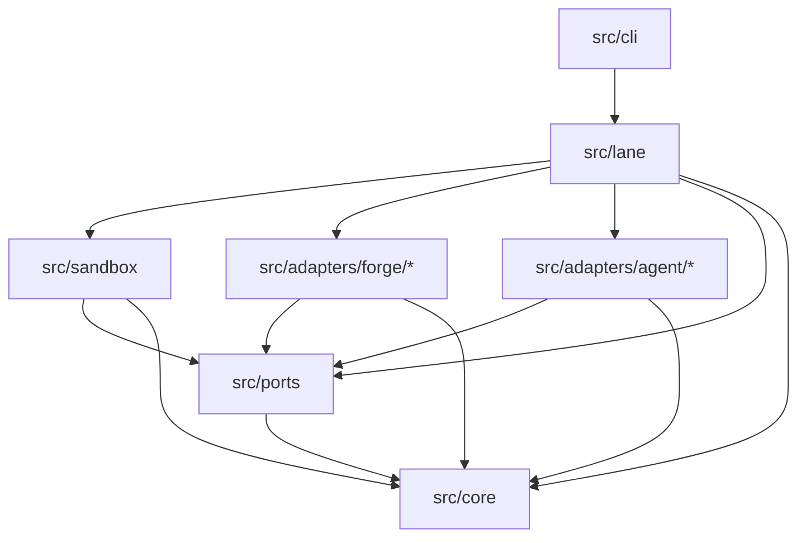
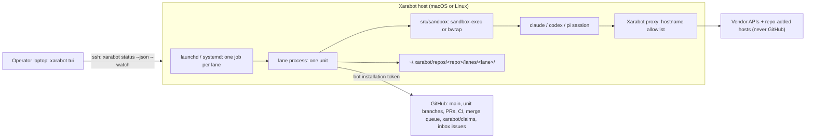
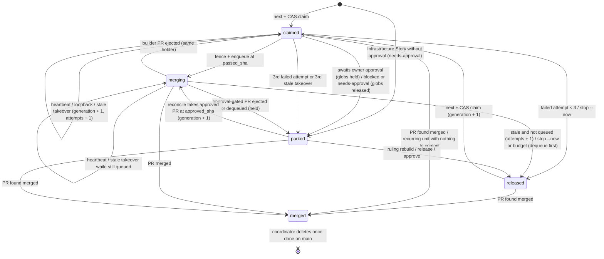

# Architecture Spine: Xarabot

Every lane that builds Xarabot follows this file. If it disagrees with `SPEC.md`, stop and ask the Maintainer. The reasons for each decision are in the `.memlog.md` file next to this one.

## Design Paradigm

**Functional core, imperative shell, with ports and adapters.** Every decision is a pure function over a snapshot. The decisions are `next`, gate evaluation, ledger edits, the write check, unit-state transitions, prompt assembly and parsing rulings. The shell builds the snapshot, calls the core, and then carries out what the core returned, through ports.

| Layer | Directory | May import |
| --- | --- | --- |
| Core: pure decisions, schemas, types | `src/core/` | `src/core/` only |
| Ports: interfaces | `src/ports/` | `src/core/` |
| Adapters: forge (`github`; later `local`) and agent (`claude`, `codex`, `pi`) | `src/adapters/forge/*`, `src/adapters/agent/*` | `src/ports/`, `src/core/` |
| Sandbox: profile, proxy, the only process launcher for agents | `src/sandbox/` | `src/ports/`, `src/core/` |
| Shell: the lane process for one unit | `src/lane/` | everything above |
| CLI: `xarabot <command>` | `src/cli/` | `src/lane/` and everything it may import |



**Ports** (contract suites in `test/contracts/`, AD-27):

| Port | Operations |
| --- | --- |
| `Forge` | `snapshot()` returns the ledger tip, `main` SHA, PR states and the server's `now`. Also `ledgerSwap(oldSha, edit)`, which returns `ok` or `conflict`; `pushBranch(lease)`; PR open, update and close; `postReview`; `checks`; `enqueue(expectedHead)`; `dequeue`; inbox `renderDigest`, `alert` and `readRulings(cursor)`; `prefetch(kind)`. There is no approve operation. |
| `Agent` | `launchSpec(unit, settings, resultPath)` returns a `LaunchSpec`; `parseUsage(output)`; `effortValues(model)` |
| `Sandbox` | `run(LaunchSpec, profile)` returns the exit status, PID and timings. This is the only way any agent process is spawned. |
| `LaneStore` | PIDs, the journal, the outcome and STOP, all inside the lane state folder |

The retry loop for compare-and-swap lives in `src/lane/`; adapters do one attempt per call.

## Invariants & Rules

### AD-1: Decisions are pure; time and I/O arrive as values

- **Binds:** CAP-2, CAP-3, CAP-5, CAP-10, CAP-18, CAP-24; everything under `src/core/`.
- **Prevents:** I/O or clock reads hidden inside decisions, and decision logic copied into each forge adapter.
- **Rule:**
  - `src/core/` never calls `fetch`, `Bun.spawn`, the filesystem, `Date.now()` or `process.env`.
  - Only adapters and `src/sandbox/` touch the forge, agents, the OS or the clock.
  - Adapters never import each other.

### AD-2: One process per unit; every wait is a sleep that can be killed; every call has a deadline

- **Binds:** CAP-4, CAP-6, CAP-15; `src/lane/`.
- **Prevents:** long-lived daemons that build up state, agent sessions that outlive their unit, and lanes that hang without ever losing their claim.
- **Rule:**
  - A lane's launchd or systemd job starts one process. The process runs at most one unit, waits, then exits.
  - The process writes its PID to `lane.pid` and keeps its heartbeats going through its trailing wait.
  - Every wait is a child `sleep` whose PID is in `wait.pid`. This covers the gaps between units (1 min after progress, 30 after idle, 15 after a failure) and usage-limit sleeps.
  - `xarabot wake <lane>` kills exactly that PID after checking it is still that `sleep`.
  - Every forge, git or HTTP call has a deadline, enforced with `AbortSignal`. git runs with `GIT_TERMINAL_PROMPT=0`.
  - A unit that goes over its wall-clock budget stops heartbeating and is released as a failed attempt. The budget is config, default 6 hours.
  - Code never calls `pkill` and never calls a `timeout` binary.

### AD-3: Every piece of state has one home and one writer

- **Binds:** CAP-3, CAP-4, CAP-6, CAP-9, CAP-10; every module that writes state.
- **Prevents:** builders writing status, and two writers of one fact.
- **Rule:** the only writers are the ones listed below. Any other write is a defect.

| State | Home | Writer |
| --- | --- | --- |
| Epic and Story planned or done | `sprint-status.yaml` on `main` | coordinator (its own PRs) |
| Retro verdicts and items | `retro-gates.yaml` on `main` | `reconcile`'s runner code only, once, from the retro unit's validated result (AD-12); then only rulings and status changes |
| BMAD's copy of retro action items | `sprint-status.yaml` `action_items` | stock `bmad-retrospective`; used only to validate the retro result, never read by gates, `next` or the digest |
| Checkpoint go | `retro-gates.yaml` on `main` | `reconcile`'s runner code, applying a Maintainer ruling (AD-28); never an agent session |
| Story manifests and `epics.md` | `main` | coordinator (planning units); a change to the effective Epic graph is Maintainer-gated (AD-11) |
| Epic graph | `.xarabot/epics.yaml` on `main` | coordinator (planning units, Maintainer-gated, AD-11) or the Maintainer |
| Ledger records in `claimed` or `merging` | ledger (AD-4) | the lane that holds the unit. Any lane may take over a stale record by compare-and-swap at `generation` + 1 (AD-6, AD-13). |
| Ledger records in `parked` | ledger | the lane that parks the unit. The coordinator's `reconcile` unit may take a held record at `generation` + 1 to enqueue it. |
| Ledger records in `released`; an Infrastructure approval | ledger | the lane releasing the unit, or the coordinator applying a ruling (AD-28) |
| Ledger records in `merged` | ledger | any lane that sees the PR merged (an idempotent edit). Only the coordinator deletes the record, and only once the unit is done on `main` (AD-9). |
| Branch, PR, CI and merge queue | forge | runner, through the `Forge` port |
| Inbox digest body | forge issue | coordinator |
| Urgent alert comment | forge issue | any lane (AD-23) |
| The `status:` line of the unit's own Story file | PR diff | the agent session (BMAD) |
| Journal, PIDs, outcome | lane state folder | that lane's process |
| `STOP` marker | lane state folder | the operator |

### AD-4: The unit ledger is the `xarabot/claims` branch, updated by compare-and-swap

- **Binds:** CAP-3, CAP-4, CAP-14, CAP-24.
- **Prevents:** a merged Story being picked again, blocked units having no home, and two lanes winning one unit.
- **Rule:**
  - The ledger is the branch `xarabot/claims`. It holds `units/<unit-file-id>.json` for each unit (AD-5) and `coordinator.json`.
  - **A swap.** Every write fetches the tip and applies a pure edit **that re-checks every precondition against that tip**: the unit's state, owner and generation, and that its globs don't overlap the globs of any `claimed`, `merging` or held `parked` record. The swap is fast-forward-only: `PATCH git/refs` with `force: false` on GitHub, `git update-ref <ref> <new> <old>` in local-only mode.
  - **A conflict.** The lane re-fetches and retries with jittered back-off. If a precondition fails on the new tip, the lane runs `next` again.
  - **Commit messages.** Ledger commits carry `[skip ci]`.
  - **Snapshot order.** A snapshot reads the ledger first, then `main`, then the PR state of every ledger unit.
  - **When they disagree,** the ledger wins over `main`.
  - **Human Live Steps:** a ruleset that blocks force-push and deletion of `xarabot/claims`, and a check that no other ruleset matches that branch.

### AD-5: Ledger records are a versioned state machine, and the forge supplies the time

- **Binds:** CAP-3, CAP-14.
- **Prevents:** clock skew between hosts; lost attempt counts; hosts on different versions misreading each other's records.
- **Rule:**
  - **Record fields:**
    - `schema_version`, `unit`, `state`
    - `owner`, `host`, `lane`, `generation`
    - `globs` (stored resolved, as of the claim)
    - `heartbeat_at`
    - `pr`, `pr_owner`, `base_sha`, `head_sha`, `reviewed_sha`, `passed_sha`, `approved_sha`
    - `builder_providers[]`: every model provider whose session changed the diff
    - `park` (`kind`, `reason`, `inbox_owner`, `globs_held`)
    - `attempts`, `loopbacks`, `ci_fixes`. These counters live in the record, so a takeover never resets a cap.
    - `approval` (`by`, `manifest_sha`)
  - **States:** `claimed`, `merging`, `parked`, `released`, `merged`. The diagram in the Structural Seed is normative.
  - **Records are never deleted** except `merged` records, which the coordinator removes (AD-3). `generation` only ever goes up, and `attempts` is kept on release.
  - **Time.** `now` is the forge server's time, returned by `Forge.snapshot()`. Local-only mode uses the host clock. The host clock is used only for local sleep lengths.
  - **Unknown schema.** A lane that meets a `schema_version` it doesn't know, or a newer one, stops before running `next` and posts an alert. Failing closed is the rule here.
  - **`host`** is a UUID that `xarabot lane install` writes to `host.yaml`. It is not the machine's hostname.

### AD-6: Heartbeat every 5 minutes; fence each action with a compare-and-swap

- **Binds:** CAP-3, CAP-6, CAP-15.
- **Prevents:** a lane that went quiet and lost its claim pushing or merging over the lane that took over.
- **Rule:**
  - A heartbeat runs every 5 minutes, for `claimed` records and for `merging` records that a builder lane holds. `merging` records that `reconcile` holds have no heartbeat and can never be taken over (AD-7).
  - **A stale `claimed` record** (no heartbeat for 30 minutes) can be taken over by any lane: `generation` + 1, `attempts` + 1, and on the 3rd it becomes `parked` (blocked) instead.
  - **A stale `merging` record that a builder lane holds:**
    - If its PR merged, it becomes `merged`.
    - If its PR is still in the queue, any lane may take it over and keep watching it.
    - Otherwise it becomes `released`, with `attempts` + 1 and `pr` kept.
  - `parked` records never expire.
  - **Retries.** The lane gives up a compare-and-swap retry loop after 10 tries or when the call's deadline passes, whichever comes first.
  - Right before each push, PR change, enqueue or merge, the lane does a heartbeat swap that requires its own `owner/host/lane` and `generation`. If the swap fails, the lane abandons the unit.
  - Pushes use `--force-with-lease` against the record's `head_sha`.
  - Enqueue and merge pass the expected head SHA.

### AD-7: What each outcome does to the ledger

- **Binds:** CAP-3, CAP-8, CAP-9, CAP-15, CAP-20, CAP-23.
- **Prevents:** a blocked unit looping, a unit holding its globs forever, and a failure cap that never trips.
- **Rule:**

| Outcome | Ledger becomes |
| --- | --- |
| About to enqueue | `merging`, written before the enqueue call |
| Merged | `merged` |
| Finished PR waiting for its owner's approval, or the Maintainer's for a graph change (AD-11) | `parked`, holding **only the paths its diff changes** |
| Blocked: Escalation, Human Live Step, `intent-gap`, `verification`, `other`, review disagreement past the cap, CI-fix cap reached, write-check refusal, or the result `no-op` | `parked`, globs **released**, inbox item |
| Session crash, a missing or invalid result, a timeout, or a budget overrun | `released` with `attempts` + 1. Once `attempts` ≥ 3 it becomes `parked` (blocked) instead. |
| A stale claim taken over by another lane | stays `claimed` under the new holder, with `attempts` + 1. Once `attempts` ≥ 3 it becomes `parked` (blocked) instead. |
| A recurring unit (`planning`, `reconcile`) with nothing to commit | `merged` with no PR. The coordinator deletes it at once, and no inbox item is raised. |
| An approval-gated PR (owner or Maintainer) ejected or dequeued from the queue | `parked`, holding only the paths its diff changes, `approved_sha` cleared. It never returns to `claimed`. |
| Infrastructure Story with no matching approval | `parked` (`needs-approval`), globs released, item in the Maintainer's inbox |
| Idle | no record |
| `STOP` | the current unit finishes first; no new claim |
| `stop --now`, or STOP during a usage-limit sleep | the lane's own `STOP` marker is written, then `released` without counting an attempt |

Every move out of `merging` other than to `merged` dequeues the PR first. Every cap (`attempts`, `loopbacks`, `ci_fixes`) is tested with `>=`.

**`merging` records the coordinator holds.** A `merging` record that `reconcile` holds is checked by later `reconcile` runs, not by heartbeat. If the PR merged, it becomes `merged`. If it is still queued, it is left unchanged. If it was ejected or dequeued, it becomes `parked` (held). No attempt is counted either way.

### AD-8: The coordinator role is a claim

- **Binds:** CAP-4, CAP-14.
- **Prevents:** two coordinators, and false "coordinator dead" alerts during idle waits.
- **Rule:**
  - Each repo has one `coordinator.json`, heartbeated through the coordinator's units and its waits.
  - The same identity, `<owner>/<host>/coordinator`, re-claims it without that counting as a takeover. A different identity refuses to start while the claim is live.
  - If the record is expired or missing, builders keep going and post the AD-23 alert.

### AD-9: One branch and one PR per unit; wip never leaves the host

- **Binds:** CAP-3, CAP-6, CAP-14.
- **Prevents:** duplicate PRs, units built twice after a merge outside the process, and branch collisions between unit kinds.
- **Rule:**
  - **Branch names.** Stories use `<story-namespace><story-id>` (Xarabot: `story/9.3`). Every other unit uses `<xarabot-namespace><kind>-<id>` (default `xarabot/retro-item-9.12`). Repo config sets both namespaces.
  - **One-shot and recurring units.** `story`, `retro`, `retro-item` and `checkpoint` are one-shot. `planning` and `reconcile` recur, so each run's id carries a run number (`planning:<slug>.<n>`, `reconcile:<n>`), with `n` one more than the last on the ledger.
  - **Every claim** looks at the unit's branch and every PR on it, in any state:
    - A merged PR means write `merged`.
    - An open PR means adopt it. The record's `head_sha` is set to the PR's actual head.
    - A closed PR, or no PR, means start from `origin/main`.
  - **A `rebuild` ruling** closes the unit's open PR and clears `reviewed_sha` and `passed_sha`.
  - **Done on `main`**, per kind:
    - `story`: `done` in `sprint-status.yaml`.
    - `retro`: a verdict in `retro-gates.yaml`.
    - `retro-item`: item status `done`.
    - `checkpoint`: the go recorded.
    - `planning` and `reconcile`: the PR merged.
  - **Wip.** Before any reset, the runner snapshots the clone's working tree as `wip/<unit>` in `runner.git` (AD-15). It never pushes wip.
  - **Restart.** A restarted lane resumes its wip only if it still holds the claim at the same generation.
  - **Cross-owner takeover (v1).** The previous owner's PR is closed with a comment, and a new PR is opened under the new owner's bot. `pr_owner` follows the new PR.

### AD-10: The Story manifest

- **Binds:** CAP-2, CAP-3, CAP-17, CAP-18.
- **Prevents:** each Epic inventing a manifest format, Stories without globs, and two lanes resolving the same globs differently.
- **Rule:**
  - **Location.** One file per Story in a directory set by repo config (Xaravel: `stories/<id>.md`). Repo config also says whether that file is also the BMAD Story file.
  - **Required frontmatter:** `story_id`, `epic`, `sprint_key`, `title`.
  - **Paths:** either `globs`, or a key the repo maps to paths in config (Xaravel: `component`).
  - **Optional:** `depends_on`, `infrastructure: true`.
  - **Repo-only fields** are allowed and ignored. A `status` field is ignored.
  - **Glob normalization:** strip `./`; reject `!`, `..` and absolute paths; compare by character prefix, case-folded. Two globs overlap unless their literal prefixes are disjoint.
  - **The resolved globs** are stored in the ledger at claim time.
  - **Unclaimable.** A Story whose globs resolve to nothing can't be claimed and goes to the inbox.
  - **Allowed outside the globs:** a Story's diff may also carry its own BMAD Story spec file and the `status:` line of its own Story file. Nothing else outside the globs is allowed.
    - The spec file's path comes from repo config (`story_spec_path`, by default BMAD's `implementation_artifacts/spec-<sprint_key>.md`).
  - **Infrastructure Stories** can be claimed only while the ledger holds an approval whose `manifest_sha` matches the current manifest.

### AD-11: The Epic graph lives in `.xarabot/epics.yaml`, serial by default

- **Binds:** CAP-2, CAP-5, CAP-10.
- **Prevents:** a graph read from prose, loaders and gates computing different graphs, work escaping a checkpoint through an ungated file, consumers carrying a BMAD override, and the gate Story and the manifest loader counting different sets of Stories.
- **Rule:**
  - **One resolver.** A pure `resolveGraph(snapshot)` in `src/core` builds the effective graph from `.xarabot/epics.yaml`, the Epic and Story headings in `epics.md`, each manifest's `epic` and the package edges, all read from the snapshot's one `main` SHA. Gates and `next` read only its output.
  - **The file.** `.xarabot/epics.yaml` has a strict, versioned schema (AD-27): `version`, and `epics`, a map from Epic number to entry.
    - Keys match `^[1-9][0-9]*$` and are converted to numbers, because `Bun.YAML` yields string keys.
    - `depends_on` is a list of positive integers (`[]` for none). An omitted `depends_on` means the default below.
    - `checkpoint` accepts only the literal `true`.
    - Duplicate Epic keys make the file invalid. They are found by scanning the raw text, because `Bun.YAML` silently keeps the last. A multi-document file or a null `epics` is invalid.
  - **The default.** An Epic the file does not list, or lists without `depends_on`, depends on the next lower Epic number present in `epics.md`; the lowest depends on none. A repo with no file runs its Epics serially. A checkpoint is never inferred.
  - **Effective dependencies** are (`depends_on` or the default) plus the package edges, which are added only through a repo-configured map from Epics to packages.
  - **The grammar.** `epics.md` is read as stock `bmad-create-epics-and-stories` writes it, with no BMAD override:
    - an Epic is a level-2 `## Epic <int>:` heading outside fenced code. `### Epic N:` lines under `## Epic List` are ignored;
    - a Story is a level-3 `### Story <int>.<int>[a-z]?:` heading under its Epic. Its id string keeps the letter (`2.6a`).
  - **What an Epic's Stories are:** exactly the manifests whose `epic` names it. A manifest's `epic` must equal its `story_id` prefix and the Epic of its heading.
  - **A Story heading with no manifest** can't be claimed, is listed in the Maintainer's inbox, and keeps its Epic from counting as done. An Epic with no Stories is never done and holds its dependents.
  - **Where the file is read.** It is repo-layer config (AD-20), read only from freshly fetched `origin/main`, and a Protected Path. Absence is decided only from the tree listing of the snapshot's `main` SHA; any other read error fails closed.
  - **Validation stops every lane and posts an alert** on any of these:
    - an invalid file;
    - an entry or `depends_on` naming an Epic with no heading;
    - a cycle;
    - a manifest with no heading, or whose `epic` doesn't match;
    - `retro-gates.yaml` marking an Epic as awaiting a checkpoint go that the graph doesn't mark.
  - **Graph inputs** are `epics.md`, `.xarabot/epics.yaml` and the manifest directory.
    - Only `planning` units may change them (AD-30). A planning unit that does holds the pseudo-glob `xarabot:graph`, so graph changes go one at a time (AD-13).
    - A planning session edits `.xarabot/epics.yaml` in its diff like any planning file; the package prompt template states its schema (AD-29).
  - **Changing the graph.**
    - Before enqueue, the runner runs `resolveGraph` and the whole validation list above on the PR's merge result (the merge it recomputes for AD-16). A failure parks the PR blocked.
    - Any change to the effective graph needs the Maintainer's approval, appends included. The effective graph covers edges (package edges included), checkpoints, the Epic set and numbers, and each Epic's Story set.
    - A PR whose merge result changes the resolved graph, whatever files it touches, takes `xarabot:graph` in its ledger record before enqueue; a second such PR waits.
    - An Epic with a retro verdict takes no new Stories; new work goes in a new Epic.
    - The same validator runs as `xarabot graph check`, so the Maintainer can check a graph change made in an interactive `bmad-create-epics-and-stories` or `bmad-correct-course` session before merging, and a consumer can run it in CI.
    - The runner posts the delta on the PR: changed edges and checkpoints, and the Epics each checkpoint without a go holds.
    - When the Maintainer approves, the runner records `approved_graph`, the hash of the resolved graph of the approved head's merge result. Enqueue recomputes it against current `main`; on a mismatch the approval is void and requested again.
  - **Fixed once used.** An Epic number or Story id can't be renumbered or removed once it has a status beyond `backlog` in `sprint-status.yaml`, a `retro-gates.yaml` record, a ledger record in any state, or a PR on its branch; such a PR parks blocked.
  - **Retiring a checkpoint.** Only a checkpoint whose go is recorded may be retired, by removing `checkpoint: true`; the go record stays.

### AD-12: Gates on the graph

- **Binds:** CAP-5, CAP-10.
- **Prevents:** "next Epic" tests that can't be written, and parallel Epics slipping past a checkpoint.
- **Rule:** distance is measured along the graph's dependency edges (AD-11), starting from Epic E.
  - **Starting an Epic.** Epic D starts only when every Epic it depends on has all its Stories merged **and its retro done**.
  - **Retro items.** A `blocking` item from E's retro holds every Epic at distance 1 or more. Any other open item holds every Epic at distance 2 or more. Items with status `open`, `in-progress` or `waiting` count as open; `deferred` and `done` don't.
  - **Checkpoints.** A checkpoint Epic C holds every Epic that depends on it, directly or through others, until the Maintainer's go is recorded. Epics already in flight finish the Stories they hold and take no new ones.
  - **The `blocking` tag** comes from the retro result (AD-14). After stock `bmad-retrospective -H <epic>` runs, Xarabot's retro prompt (AD-29) asks for each action item's `blocking`, `route` and `globs`.
    - **Item ids.** Each result item carries the stock BMAD action-item id from `sprint-status.yaml` (`epic-<N>-retro-item-<seq>-<slug>`). `retro-item` units and `block`/`unblock` rulings use that id.
    - **Validation.** Before the squash, the runner rejects a result whose items don't match the `action_items` the diff appends one to one, or whose `verdict` differs from the retro document's frontmatter.
    - **Writing.** The runner stores the validated result in the unit's ledger record. `reconcile` writes the verdict and items to `retro-gates.yaml` once, when it marks the retro done; after that only rulings and status changes edit an item.
    - The tag stands unless the Maintainer rules `block` or `unblock` (AD-28).
  - **Graph changes** take effect at the next claim; Stories already claimed finish. A checkpoint added after an Epic's retro holds its dependents from the next claim until the go.

### AD-13: How `next` chooses

- **Binds:** CAP-2, CAP-4, CAP-9.
- **Prevents:** builders taking coordinator work, lanes ordering units differently, and coordinator edits colliding with builder edits.
- **Rule:**
  - **Signature.** `next(snapshot, laneRole)` returns either a unit or `idle` with a reason.
  - **Globs for every unit kind.**
    - Every unit kind holds globs.
    - Planning units hold the planning paths: the graph inputs (`epics.md`, `.xarabot/epics.yaml`, the manifest directory), `sprint-status.yaml`, `retro-gates.yaml` and the configured Epic context path (`epic-<N>-context.md`). A planning unit that changes a graph input also holds the pseudo-glob `xarabot:graph` (AD-11).
    - Retro and checkpoint units hold `sprint-status.yaml`, `retro-gates.yaml` and the Epic context path, never the graph inputs.
    - A retro item carries its `globs` in `retro-gates.yaml`. Without globs it can't be claimed. Its globs may not include graph inputs, status files, or anything the write check refuses a builder (AD-30).
    - `reconcile` holds no globs.
    - A parked, approval-gated PR holds only the paths its diff changes (AD-7).
    - The overlap check applies to every role.
  - **Approval-gated coordinator PRs** (a Protected Path or a graph change) never touch `sprint-status.yaml` or `retro-gates.yaml` (enforced by AD-30); `reconcile` writes their status entries after the merge. A change to both the Epic set and the graph goes in one PR.
  - **Builders** take only eligible Stories (AD-12) whose record is absent, `released`, or a stale `claimed` or `merging` record (AD-6), and whose globs don't overlap. They pick the lowest Epic number first, then the lowest Story number.
  - **Epic context.** The coordinator compiles each Epic's BMAD context file (`epic-<N>-context.md`) in planning, before the Epic's Stories become eligible. The runner reverts any change a builder session makes to it before squashing.
  - **The coordinator** works in this order:
    1. `reconcile`:
       - apply rulings;
       - take approved held PRs at `generation` + 1, fence, and enqueue them;
       - write `merged` records;
       - mark units done;
       - route Maintainer-only retro items in batch.
    2. Open coordinator PR.
    3. Planning.
    4. Retro.
    5. Retro items.
    6. Checkpoint.
  - **Planning shape.** 0.x supports only BMAD's classic shape: `epics.md`, `sprint-status.yaml` and manifests, plus the Epic graph file (AD-11).

### AD-14: Results, one shape per unit kind

- **Binds:** CAP-6, CAP-7, CAP-8, CAP-10, CAP-11.
- **Prevents:** sessions returning shapes of their own, and telemetry trusting what an agent reports about itself.
- **Rule:**
  - **Where the result goes.** Every session writes JSON to the path in `XARABOT_RESULT`. That path is in the sandbox's temp folder, outside the clone. The session writes it as the prompt's last step (AD-29), never from a skill hook: Xarabot needs no BMAD override.
  - **A union keyed by `kind`:**
    - `build`: `outcome` (`done` | `blocked` | `no-op`), `blocked` {`kind`, `text`, `step_id`}, `summary`, `body`, `verification[]`.
    - `review`: `reviewed_sha`, `verdict`, `findings[]` {`severity`, `blocking`, `file`, `text`}.
    - `retro`: `verdict`, `items[]` {`id`, `text`, `route`, `blocking`, `globs`}.
    - `planning`: `outcome`, `summary`.
    - Every kind also carries `denied_actions[]`, for actions the agent's permission mode refused. The agent reports them and never works around them.
  - **A missing result** first gets one resume: every stock skill ends by telling the agent to stop, so the runner resumes the session once with a prompt that asks only for the result (`claude -p --resume`; codex and pi confirmed in their adapter Stories). For builds it also cross-checks the Story spec's `status` and `## Auto Run Result`.
  - **A result still missing, or invalid,** counts as a failed attempt.
  - **Never taken from the agent:** agent, model, effort, tokens and cost (parsed by the adapter from the CLI's own output), timings, the diff, the files touched, authorship.

### AD-15: The runner owns every commit, push and forge text, in a repository of its own

- **Binds:** CAP-6, CAP-13, CAP-18; SPEC "No co-author markers".
- **Prevents:**
  - wrong authors and co-author trailers;
  - diffs on a stale base that revert other Stories;
  - agent text closing issues or pinging people;
  - git config the agent planted running code as the runner.
- **Rule:**
  - **The runner's own repository.** Each lane has a runner-private repository, `runner.git` in the lane state folder, which the sandbox can neither read nor write.
    - The runner never runs git against the agent clone's `.git`.
    - Before each session it rebuilds the clone, `.git` included, from `runner.git`.
      - A first build session starts at `base_sha`.
      - A loopback or CI-fix session starts at the current `head_sha`, with the review findings or CI log prefetched into its temp folder.
    - Afterwards it reads only the clone's working tree.
  - **Acting on a PR this lane didn't build.** Before acting on it, the lane fetches the PR's branch head and `passed_sha` from the forge into its own `runner.git`. That covers takeover, `reconcile` enqueue, reviewer checkouts and the clean-merge recompute. A restart at the same generation re-reads the PR head the same way.
  - **The commit.** In `runner.git` the runner takes the working tree's changes against `base_sha`, applies them on top of `origin/main` as a three-way merge (a conflict follows AD-19), and makes one commit authored by `<login>-xarabot[bot]`. It records `base_sha` and `head_sha`.
  - **Wip** is kept as a `wip/<unit>` ref in `runner.git`, never in the clone.
  - **Agent text.** A pure sanitizer strips trailers, closing keywords and `@mentions` from `summary` and `body` before any commit message, PR text or comment uses them.
  - **Only the runner** pushes, opens PRs, comments, enqueues and merges.
  - **Never:** an admin merge, or GitHub auto-merge.

### AD-16: The runner enforces the cross-vendor review, tied to the head SHA

- **Binds:** CAP-8.
- **Prevents:** a review the builder reports about itself, and a merged diff that differs from the reviewed one.
- **Rule:**
  - **Picking the reviewer.** The reviewer must come from a provider not in the record's `builder_providers[]`.
    - **A session's provider** is the vendor of the model it runs, never the adapter's name. `claude` is Anthropic and `codex` is OpenAI. A pi session's provider is the vendor named in its `<provider>/<id>` model; through OpenRouter, that is the vendor of the underlying model.
    - **Which reviewer:** the first allowed adapter from (`claude`, `codex`) whose provider is not in the set.
    - If no allowed reviewer is left, the unit parks blocked.
    - pi lanes must set `model` explicitly.
    - If the model a session reports differs from its config, the attempt fails.
  - **The session.** The review runs over a fresh checkout of `head_sha` that the runner makes from `runner.git`, never in the builder's clone.
    - Agent config paths (AD-30) are restored from `main`, so nothing the builder wrote can configure the reviewer.
    - Hooks are off, and the reviewer gets a freshly seeded vendor home.
    - The runner records `reviewed_sha` itself, and the review is posted on the PR naming that SHA.
  - **Passing.**
    - A review with no blocking findings also sets `passed_sha`. A review with blocking findings never does, so a lane that takes over picks up the loopback, not the enqueue.
    - Enqueue happens only if the PR head equals `passed_sha`, or if the head's tree equals the merge of `passed_sha` with the head's `main` parent.
    - The enqueuing lane recomputes that merge itself in `runner.git`. It never trusts the record or the commit's author for this.
  - **Owner-gated PRs** (Protected Paths) are enqueued only while the owner's approval is on the current head (`approved_sha` equals the head).
  - **Graph-changing PRs** (AD-11) are enqueued only while the Maintainer's approval is on the current head and `approved_graph` matches; the bot owner's approval alone never counts.
  - **`reconcile` PRs** carry only runner-written content, so they get no agent review and no agent loopback. On a conflict or an ejection, `reconcile` regenerates them on fresh `main`.
  - **Any later change by an agent re-runs the review.** That covers CI fixes and conflict resolution, and each re-run counts as a loopback, at most 2. Past the cap, the unit parks blocked.
  - **Coordinator PRs** follow the same rule, except `reconcile` PRs (below).
  - **At lane start,** the lane refuses to run if the reviewer adapter isn't allowed.
  - **BMAD's own review hook** may run for earlier feedback, but it never counts as the gate.

### AD-17: One sandbox launches every agent

- **Binds:** CAP-7, CAP-18; SPEC "Agents never touch GitHub".
- **Prevents:** an adapter spawning an agent outside the boundary, and agents reaching a GitHub credential or another lane's secrets.
- **Rule:**
  - **The only launcher.** Only `src/sandbox/` spawns agent and reviewer processes. A lint rule bans `Bun.spawn` under `src/adapters/agent/`.
  - **The mechanism.** On macOS, `sandbox-exec` with a generated profile, re-tested on every new macOS major version. On Linux, `bwrap` with `--unshare-pid`. Each agent's own sandbox is turned off inside it.
  - **A private vendor home per session.** Each lane keeps its own vendor home under its state folder, re-seeded before every session (builder or reviewer) so that it holds only that vendor's credential. The adapter points the CLI at it (`CLAUDE_CONFIG_DIR`, `CODEX_HOME`, pi's agent directory).
    - On macOS, `claude` gets its credential as `CLAUDE_CODE_OAUTH_TOKEN`, because the keychain is unreadable.
    - The operator's own `~/.claude`, `~/.codex` and `~/.pi` are neither readable nor writable.
    - `[ASSUMPTION: pi's directory override is confirmed in the pi adapter Story]`
  - **Reads** are denied by default. Allowed: system paths, the lane's clone, the lane's vendor home and its temp folder. `~/.xarabot/**`, `$XDG_CONFIG_HOME/xarabot` (or `~/.config/xarabot`), `~/.config/gh`, `~/.ssh`, `~/Library/Keychains`, `~/.git-credentials` and `~/.netrc` are always denied.
  - **Writes** are allowed to the lane's full clone (never a linked worktree), `.git` included, because the runner never trusts it (AD-15). The lane's vendor home and its temp folder are writable too. `runner.git` is never readable or writable.
  - **Environment.** Only an allowlist of variables passes through. The git credential helper is reset and Unix sockets are denied.
  - **Network** goes only through Xarabot's Bun proxy, to the vendor's API hosts, `pypi.org` and `files.pythonhosted.org` (stock skills run `uv run --no-cache` with Python 3.11+ and `ruamel.yaml`), plus hosts the repo adds. Reads of the uv-managed Python install are allowed. **A GitHub host is never allowed.** `[ASSUMPTION: the proxy's hostname allowlist is proven by a spike in the sandbox Story]`
  - **GitHub data.** A session that needs it reads files the runner fetched beforehand into the temp folder.
  - **Fail closed.** If the sandbox can't be set up, the session is refused.

### AD-18: The runner never runs repo code or exposes its token

- **Binds:** CAP-6, CAP-18.
- **Prevents:** code an agent wrote running next to the bot's token, and the token leaking through the environment, argv or logs.
- **Rule:**
  - **Repo commands** the runner needs, such as regenerating a lockfile, run inside the AD-17 sandbox with no token.
  - **The runner's own git** runs only against `runner.git` (AD-15), with:
    - `GIT_CONFIG_NOSYSTEM=1` and `GIT_CONFIG_GLOBAL=/dev/null`;
    - `credential.helper=` reset before the runner's own helper is added;
    - `core.hooksPath=/dev/null`, and no `fsmonitor`, filters, external diff, textconv or signing program;
    - `GIT_NO_REPLACE_OBJECTS=1` and `protocol.file.allow=never`;
    - no submodule recursion.
  - **The diffs** for the write check (AD-30) and for review are computed by the runner from git objects under those settings.
  - **The token** reaches git only through a credential helper over stdin, scoped to the forge's URL. It never appears in env, argv, a file or a log.

### AD-19: CI and merge plumbing `[ADOPTED Lessons]`, plus the fix loop

- **Binds:** CAP-6, CAP-11.
- **Prevents:** repeating Xaravel's costly failures, CI failures with no next step, and wasted API budget.
- **Rule:**
  - **Polling.** Poll by hand, never `gh pr checks --watch`: every 30 s, backing off to 5 min. Stop at the first failure not on `policy.yaml`'s list of expected checks. An empty reply means pending.
  - **CI max wait.** Default 60 min. After that, the unit parks blocked.
  - **A CI fix.** An unexpected failure starts a CI-fix builder session, at most **2** per unit. Each fix is journaled as `ci_fixes`, then reviewed again (AD-16).
  - **Conflicts.**
    - Merge `origin/main` into a conflicting PR before polling.
    - In status YAML, keep `main`'s lines and re-apply the PR's own entries.
    - Regenerate a lockfile inside the sandbox.
    - Hand any other conflict to a builder session, which counts as an attempt.
  - **Merging.**
    - Squash through the merge queue, never with `--delete-branch`.
    - If the queue ejects the PR, merge `main`, poll again and re-enqueue. This counts toward `attempts`.
    - The merge queue is a consumer prerequisite (AD-33).

### AD-20: Config has three layers; repo policy comes from `main` and fails closed

- **Binds:** CAP-1, CAP-7, CAP-22.
- **Prevents:** a lane obeying policy that its own branch edited, and merges continuing after authority is revoked.
- **Rule:**
  - **Package layer:** defaults, schemas, the prompt template.
  - **Repo layer:** `.xarabot/` (`config.yaml`, `policy.yaml`, `human-live-steps.yaml`, `epics.yaml`, `prompts/`) plus the Standing Authority file at the path config names. This layer is read **only from freshly fetched `origin/main`**.
  - **Host layer:** `host.yaml`, `XARABOT_HOST` and `XARABOT_MAX_BUILDERS`.
  - **Format.** All config is YAML with a versioned schema.
  - **Standing Authority.** It is valid when it exists on `main` and its YAML frontmatter validates against the Standing Authority schema. `[ASSUMPTION: Xaravel's MAINT file gains that frontmatter in its adoption Epic]`
  - **Fail closed.** If config, policy or the Standing Authority is missing, invalid or can't be fetched, the lane stops. The one exception: an absent `epics.yaml` means the serial default (AD-11); any error reading it still stops the lane.
  - **Re-checks from freshly fetched `main`:**
    - the Standing Authority, before every claim, push, enqueue and merge;
    - the adapter and reviewer allowances, before every session launch and every enqueue.
  - **Protected Paths in the consumer:**
    - `.xarabot/**`, the Standing Authority file and `.github/**`;
    - **agent config at any depth:** `**/.agents/**`, `**/.claude/**`, `**/.codex/**`, `**/.pi/**`, `**/.mcp.json`, `**/AGENTS.md`, `**/CLAUDE.md`.

### AD-21: Lanes are host config, bound to a repo; effort defaults to `high`

- **Binds:** CAP-4, CAP-7, CAP-13.
- **Prevents:** lanes for two repos colliding on one host, effort silently dropped, and agents running without approval.
- **Rule:**
  - **What a lane has.** Each lane in `host.yaml` has `repo`, `role`, `owner`, `agent`, `model` and `effort`. Its state lives under `~/.xarabot/repos/<owner>__<name>/lanes/<lane>/`.
  - **Defaults.** An unset `model` uses the adapter's default, and an unset `effort` is `high`.
  - **Effort mapping:** `claude --effort`, `pi --thinking`, `codex -c model_reasoning_effort`, each with the same value names.
  - **The lane refuses to start** if:
    - its agent isn't allowed unattended;
    - its effort isn't offered by that adapter for that model;
    - the reviewer adapter isn't allowed;
    - the App installation doesn't cover the repo;
    - the host would run more builders than `XARABOT_MAX_BUILDERS`, which counts across all repos.

### AD-22: Stopping, time limits and usage limits

- **Binds:** CAP-6, CAP-15.
- **Prevents:** lanes that can't be stopped for hours, sessions that hang, and sleeps that never end.
- **Rule:**
  - **STOP markers.** `~/.xarabot/STOP` stops the whole host, and a lane's own `STOP` stops that lane. Both are checked at process start, before `next` and before each claim. A STOP also ends a usage-limit sleep (AD-7).
  - **`stop --now`:**
    1. Write the lane's `STOP` marker, so launchd or systemd can't relaunch it into a new claim.
    2. Kill by recorded PID, in the order `lane.pid`, `agent.pid`, `wait.pid`, checking each PID's start time and command first.
    3. The CLI itself applies AD-7.
  - **Session limits.** An agent session has 3 hours. A session still alive 5 minutes after its result file appears is killed.
  - **Usage limits.** Sleep until the reset plus 2 minutes, or 15 minutes if the reset can't be parsed, never more than 8 hours. The sleep can be woken, the heartbeat continues, and the unit budget (AD-2) still applies.

### AD-23: The inbox goes through the forge port

- **Binds:** CAP-9, CAP-23.
- **Prevents:** notification spam, alerts that never fire because their only writer is stopped, and the 3-pinned-issue limit.
- **Rule:**
  - **The issue.** Each owner has one issue labelled `xarabot-inbox`, assigned to them. Only the Maintainer's is pinned, and the Maintainer pins it once by hand (a Human Live Step).
  - **The digest.** The coordinator rewrites the body daily from the ledger's `parked` records, PR states and `retro-gates.yaml`. Maintainer-only retro items are routed in batch.
  - **Urgent alerts.** Any lane may post a single @mention comment for a condition that newly stops every lane. Alerts are deduplicated by (condition, `main` SHA). The comment is allowed even while the lane is failing closed.
  - **App permissions.** The App gains `issues: write`. Adding it to an App that already exists is a Human Live Step.

### AD-24: Telemetry and the TUI read; they never decide

- **Binds:** CAP-11, CAP-12.
- **Prevents:** decisions resting on a second source of truth, and a success metric that can't be computed.
- **Rule:**
  - **The journal.** Each lane appends to `journal.jsonl` one record per unit (the facts from AD-14 plus `outcome`, `loopbacks`, `ci_fixes`) and one record per idle or waiting span, with its reason (`waiting-on-maintainer`, `usage-limit`, `idle`). Subscription cost is labelled an estimate.
  - **The report.** `xarabot report` computes the SPEC's Stories-per-hour figure, leaving out hours when every lane is `waiting-on-maintainer`.
  - **The TUI.** `xarabot status --json --watch` is the only status interface. The TUI draws it, locally or over `ssh $XARABOT_HOST`.
  - **Retention.** Logs are kept 30 days. Journals are kept forever.

### AD-25: The runner is installed pinned, never from its own build

- **Binds:** CAP-1; SPEC "Pinned runner".
- **Prevents:** a bad Story breaking the runner that would build the fix.
- **Rule:**
  - **Which version.** A lane runs `~/.xarabot/runner/<version>/`, where the version comes from `runner_version` in `.xarabot/config.yaml` on its repo's `origin/main`.
  - **Consumers.** A consuming repo's exact `@xaravel/xarabot` pin must equal `runner_version`, or the lane refuses to start. Xarabot's own repo has no such dependency; for it, `runner_version` alone is the pin.
  - **Who changes it.** Only the Maintainer advances `runner_version`, since `.xarabot/**` is protected. Recovery means pinning back.
  - **Install.** `xarabot lane install` installs that version and writes the launchd plist or systemd unit, with a restart throttle (AD-33).

### AD-26: Keys and tokens `[ADOPTED from bootstrap/join.ts]`

- **Binds:** CAP-13, CAP-14.
- **Prevents:** long-lived tokens, and key paths that differ between machines.
- **Rule:**
  - **The key and its record.** The App's key is at `$XDG_CONFIG_HOME/xarabot/apps/<login>-xarabot/private-key.pem` (falling back to `~/.config`), mode 600. `app.json` next to it records the App's ID and slug.
  - **Tokens.** Installation tokens are minted on demand, last 1 hour and stay in memory only.
  - **App rights.** The App has no admin, bypass or approve rights, and the `Forge` port has no approve operation.
  - **`workflows: write`** is deliberately absent. A diff that touches `.github/workflows/**` is a write-check refusal (AD-30).

### AD-27: One schema library; every port has a contract suite

- **Binds:** all Epics.
- **Prevents:** different validators for the same shape, and adapters drifting apart.
- **Rule:**
  - **Schemas.** Every runtime-validated shape has one schema in `src/core/schemas/`, and its TS type is inferred from it. That covers config, policy, the Standing Authority, manifests, ledger records, results, `retro-gates.yaml`, rulings, prefetched GitHub data, the journal, status and the `Snapshot`. `[ASSUMPTION: zod 4]`
  - **The `Snapshot`.** Its fields are named, so every core function reads the same names:
    - `now`
    - the ledger tip and its records
    - the `main` SHA
    - the config, policy and Standing Authority
    - manifests and the resolved Epic graph (`resolveGraph`, AD-11), all from the one `main` SHA
    - `sprint-status.yaml` and `retro-gates.yaml`
    - the PR state of every ledger unit
    - the lane's identity and role
  - **YAML and globs.** YAML is parsed with `Bun.YAML`, and globs are matched with `Bun.Glob`.
  - **Contract suites.** Each port has one suite in `test/contracts/`, and every adapter passes it. The suites include many lanes racing on the ledger and every forge error kind (AD-32).

### AD-28: Rulings are comment commands on the inbox issue

- **Binds:** CAP-5, CAP-9, CAP-13, CAP-20.
- **Prevents:** parked units nobody can clear, checkpoints with no way to record the go, and Infrastructure Stories with no recorded approval.
- **Rule:**
  - **Grammar:** `/xarabot <verb> <unit-id>`, where the verb is `go` (a checkpoint), `approve` (an Infrastructure Story), `block` or `unblock` (a retro item's `blocking` tag), `rebuild`, `release` or `dismiss`.
  - **Who counts.** `go`, `approve`, `block` and `unblock` are accepted **only from the Maintainer** (set in config). `rebuild`, `release` and `dismiss` are accepted from the item's owner or the Maintainer.
  - **What each verb does to the record:**
    - `release` and `rebuild` reset `attempts`, `loopbacks` and `ci_fixes` to 0.
    - `rebuild` also closes the PR (AD-9) and clears `builder_providers[]`, because the diff starts again from `main`.
    - `release` keeps `builder_providers[]`, because the existing diff carries over. A unit parked because no reviewer is left therefore needs `rebuild`.
    - `dismiss` removes only the inbox item and leaves the ledger unchanged.
  - **Applying it.** Rulings, the checkpoint go included, are applied by `reconcile`'s runner code, never by an agent session. The coordinator's `reconcile` unit reads new comments from a cursor kept in `coordinator.json`. It applies each ruling with a ledger or `retro-gates.yaml` edit, then replies with a 🤖 acknowledgement.
  - **Local-only mode (v1)** uses `xarabot rule <verb> <unit-id>`.

### AD-29: Prompt assembly is pure

- **Binds:** CAP-2, CAP-6, CAP-21, CAP-23.
- **Prevents:** selection, CI, merge or status instructions leaking into prompts, and each adapter assembling its own.
- **Rule:**
  - **The function.** `core/prompt` builds every session's prompt from the package template, the repo's `prompts/` sections, the unit id, the Human Live Steps list, the result path and (v1) Lessons. All inputs come from fetched `origin/main`.
  - **Contents.** The prompt names the unit ("Build Story 9.3"). A test asserts it contains no selection, CI, merge or status instruction.
  - **Stock skills only.** The prompt runs the stock BMAD skill for the unit, then, as its last step, has the session write its result to `$XARABOT_RESULT` in the schema for its unit kind (AD-14). Xarabot never writes or requires `_bmad/custom/` in a consuming repo.

| Unit | Stock skill and unattended invocation |
| --- | --- |
| `story` (first build) | `bmad-build-auto` for the Story |
| `story` (loopback or CI fix) | none: the prompt applies the prefetched findings or CI log directly |
| `retro` | `bmad-retrospective -H <epic>`, then each action item's `id`, `blocking`, `route` and `globs` (AD-12) |
| `planning` | `bmad-sprint-planning`, told to run headless; manifests, Epic context and graph edits (AD-11) |
| `retro-item` | none: the prompt names the item |

  - **Never run by a lane:** `bmad-create-epics-and-stories` and `bmad-correct-course`, which have no headless mode. The Maintainer runs them; a needed course correction goes to the Maintainer's inbox.
  - **The clone** is on the unit's branch before the session starts.
  - **Session settings.** Adapters pass the attribution-off setting for their CLI (for example `claude --settings {"attribution": false}`).

### AD-30: A 0.x write check before every squash

- **Binds:** CAP-4, CAP-18 (part of 0.x); AD-3.
- **Prevents:** builders writing coordinator-owned files, and agents widening their own policy before the v1 diff check exists.
- **Rule:**
  - **Builder diffs are refused** if they touch any of: coordinator-owned files (AD-3), manifests, `.xarabot/**`, the Standing Authority file, `.github/**`, agent config at any depth (AD-20), or the repo's Protected Paths.
    - **Exceptions:**
      - an Infrastructure Story with a matching approval (AD-10). This covers the repo's Protected Paths only, never coordinator-owned files, manifests or `.xarabot/**`;
      - the unit's own BMAD Story spec file;
      - the `status:` line of the unit's own Story file.
  - **Coordinator diffs** may touch only the paths their unit holds (AD-13). Only a `planning` unit may touch a graph input, and under `.xarabot/**` only `.xarabot/epics.yaml`. A diff touching both a graph input and `sprint-status.yaml` or `retro-gates.yaml` is refused.
  - **Retro records.** Any agent diff, builder or coordinator, that changes a retro verdict, a retro item or a checkpoint go in `retro-gates.yaml` is refused (AD-12, AD-28).
  - **Whose diff.** The diff checked is the agent session's own change, never runner-written content such as `reconcile`'s.
  - **A refusal** parks the unit as blocked (AD-7) and is logged with its reason.

### AD-31: Bootstrap runs as a dedicated macOS user; self-hosting waits for the sandbox

- **Binds:** SPEC "Bootstrap" and "Self-host"; CAP-18.
- **Prevents:** the bootstrap agent reaching the Maintainer's GitHub login, and an unsandboxed self-hosted runner.
- **Rule:**
  - **The user.** The bootstrap copy of Xaravel's loop runs under a dedicated macOS user on the Xarabot host. That user holds only the bot's private key, the Claude credential and its own clone. It has no `gh` login, no ssh key and no GitHub keychain item.
  - **Permissions.** The Maintainer's home directory is mode 700, so the bootstrap user can't read it.
  - **Tokens.** The loop mints bot installation tokens from the key each iteration.
  - **Self-hosting** happens only once AD-17's sandbox runs in the first Epic.

### AD-32: Forge errors have kinds, and each kind has an action

- **Binds:** CAP-6, CAP-13, CAP-24.
- **Prevents:** adapters handling 401, 403 and rate limits each their own way, and heartbeats lapsing quietly.
- **Rule:**
  - **The kinds.** `Forge` errors are `conflict`, `not-fast-forward`, `auth`, `forbidden`, `rate-limited` (with `retry_after`), `not-found`, `uninstalled` and `transient`.
  - **`rate-limited` and `transient`:** back off within the call's deadline. A heartbeat that would lapse releases the unit.
  - **`auth`, `forbidden` and `uninstalled`:** stop the lane and post an alert.

### AD-33: Operations and consumer prerequisites

- **Binds:** CAP-1, CAP-4, CAP-13.
- **Prevents:** crash loops, CI noise, and consumers that are missing settings the architecture relies on.
- **Rule:**
  - **Restart throttle.** launchd and systemd restarts are throttled. A lane that fails to start 3 times in a row writes its own `STOP` and posts an alert.
  - **Consumer prerequisites.** These are Human Live Steps, checked at lane start where the API allows:
    - the `xarabot/claims` ruleset (AD-4);
    - the merge queue enabled on `main`;
    - squash messages set to PR title + body;
    - Protected Paths requiring the owner's review, with stale approvals dismissed on push and approval of the most recent push required;
    - the App installed with `issues: write`.

## Consistency Conventions

| Concern | Convention |
| --- | --- |
| Epic and Story ids | The Epic key is an integer; Epic slugs are only metadata. `story_id` matches `^\d+\.\d+[a-z]?$` and sorts numerically by part, then by suffix. |
| Unit ids | `story:<story_id>`, `retro:<epic>`, `retro-item:<bmad-action-item-id>`, `checkpoint:<epic>`, `planning:<slug>.<n>`, `reconcile:<n>`. A ledger file name replaces `:` with `__`. |
| Lane identity | `<owner>/<host-uuid>/<lane>`. Lane names are `coordinator` and `builder-1` … `builder-N`, unique per host and repo. |
| Files and names | kebab-case files, `camelCase` functions, `PascalCase` types, one port per file in `src/ports/`. |
| Errors | `src/core/` returns `{ ok: true, value } \| { ok: false, error: { kind, message } }` and never throws. The shell catches at the unit boundary. |
| Timestamps | ISO 8601 UTC. |
| Logs | `logs/<unit-file-id>-<start>.log` in the lane state folder; the journal is the structured record. |
| Forge text | Written only by the runner, after sanitizing (AD-15). Status comments start with 🤖. |
| Tests | `bun test`. Core tests are case tables with no mocks. Each gate and each input of `next` has its own test. Adapters are tested through the contract suites. |
| Lint and types | `bun --bun oxlint` and `bun --bun tsc` (TypeScript 7, where `--strict` is on by default). Never run them through Node. |

## Stack

| Name | Version |
| --- | --- |
| Bun (runtime, tests, packages, `Bun.YAML`, `Bun.Glob`) | 1.4.3 |
| TypeScript | 7.0.2 |
| oxlint | 1.89.0 |
| zod | 4.6.7 |
| claude CLI (adapter target; minimum tested) | 2.1.304 |
| codex-cli (adapter target; minimum tested) | 0.163.0 |
| pi coding agent (adapter target; minimum tested) | 1.3.0 |
| bubblewrap (Linux sandbox) | 0.13.1 |

## Structural Seed

**Deployment.** Each operator has one Xarabot host, and their laptop is only for viewing.



**Ledger record states** (this diagram is normative, AD-5):



**Host layout and source tree:**

```text
~/.xarabot/
  STOP                                # host-wide stop
  runner/<version>/                   # pinned runner (AD-25)
  repos/<owner>__<name>/lanes/<lane>/
    clone/                            # agent clone, rebuilt from runner.git per session; sandbox-writable
    runner.git/                       # runner-private repo (AD-15); sandbox-unreadable
    vendor/                           # per-lane vendor home, re-seeded per session (AD-17)
    journal.jsonl  lane.pid  agent.pid  wait.pid  outcome  STOP
    logs/
$XDG_CONFIG_HOME/xarabot/             # default ~/.config/xarabot; sandbox-unreadable
  host.yaml                           # host uuid, lanes (AD-21)
  apps/<login>-xarabot/private-key.pem  app.json

src/
  core/        # next, gates, graph, ledger edits, write check, transitions, prompt, rulings, sanitizer
    schemas/   # every runtime-validated shape (AD-27)
  ports/       # forge.ts, agent.ts, sandbox.ts, lane-store.ts
  adapters/
    forge/github/
    agent/claude/  agent/codex/  agent/pi/
  sandbox/     # seatbelt profile, bwrap args, proxy, launcher
  lane/        # the one-unit process, CAS retry loop
  cli/         # join, lane install, wake, stop, rule, status, tui, report
test/contracts/
bootstrap/     # join.ts; the bootstrap loop copy runs as a dedicated macOS user (AD-31)
```

## Capability → Architecture Map

| Capability | Lives in | Governed by |
| --- | --- | --- |
| CAP-1 Packaged and pinned | package root, `src/cli` | AD-20, AD-25, AD-33 |
| CAP-2 `next` | `src/core` | AD-1, AD-10, AD-11, AD-13, AD-29 |
| CAP-3 Claims | `src/core`, `src/lane` | AD-4 – AD-9 |
| CAP-4 Parallel lanes | `src/lane`, `src/cli` | AD-2, AD-3, AD-8, AD-21, AD-30 |
| CAP-5 Parallel Epics | `src/core` | AD-11, AD-12, AD-28 |
| CAP-6 Plumbing in code | `src/lane`, `src/adapters/forge` | AD-14, AD-15, AD-18, AD-19, AD-22, AD-32 |
| CAP-7 Agent adapters | `src/adapters/agent`, `src/sandbox` | AD-14, AD-17, AD-21 |
| CAP-8 Cross-vendor review | `src/lane` | AD-16 |
| CAP-9 Inboxes | `src/adapters/forge`, coordinator | AD-7, AD-23, AD-28 |
| CAP-10 Retro gating | `src/core` | AD-12, AD-14 |
| CAP-11 Telemetry | `src/lane`, `src/cli` | AD-14, AD-24 |
| CAP-12 TUI | `src/cli` | AD-24 |
| CAP-13 Bot identity | `src/cli` (join), `src/adapters/forge/github` | AD-15, AD-26, AD-33 |
| CAP-14 Team onboarding | `src/cli`, ledger | AD-5, AD-8, AD-9, AD-26 |
| CAP-15 Deterministic stop | `src/lane`, `src/cli` | AD-2, AD-7, AD-22 |
| CAP-16 Pipelining | n/a | Deferred |
| CAP-17 Actor registry | n/a | Deferred |
| CAP-18 Guard | `src/sandbox`, `src/core` | AD-17, AD-18, AD-30; v1 diff check Deferred |
| CAP-19 Gates from the base branch | `src/lane` | AD-20; CI part Deferred |
| CAP-20 Escalations | `src/core` | AD-7, AD-14, AD-28; mechanism Deferred |
| CAP-21 Lessons | `src/core/prompt` | AD-29; injection source Deferred |
| CAP-22 Standing Authority | `src/lane` | AD-20 |
| CAP-23 Human Live Steps | `src/core`, inbox | AD-7, AD-14, AD-29; detection Deferred |
| CAP-24 Forge adapters | `src/ports/forge.ts`, `src/adapters/forge/*` | AD-1, AD-4, AD-27, AD-32 |

## Deferred

- **The spec-folder planning shape** (`stories.yaml`, folder+id dispatch). Waits until a consumer uses it.
- **The local-only forge adapter (v1).** This covers its compare-and-swap with `update-ref`, its checks, a local inbox, signing with the lane key and `xarabot approve`, all within AD-4, AD-27 and AD-28.
- **The v1 guard diff check and CI re-check** (CAP-18, CAP-19): globs, renames, symlinks, submodules, mode changes, the dependency-file list, and gates judged in the merge group. They extend AD-30.
- **A CI check that runs `resolveGraph` on human-authored PRs** waits for CAP-19 in v1. Until then the Maintainer's approval and the post-merge validation (AD-11) cover them.
- **Removing a PR already in the queue when authority is revoked** waits for CAP-19 in v1. Until then this is an accepted 0.x gap.
- **Xarabot-owned Escalations (v1, CAP-20).** In 0.x, Xaravel's `tools/escalations/` is read through config.
- **Injecting Lessons (v1, CAP-21).** They come from fetched `origin/main` when each session starts.
- **The Actor registry and generated CODEOWNERS and rulesets (v1, CAP-17).**
- **Detecting Human Live Steps beyond `blocked.kind` (v1, CAP-23).**
- **Pipelining (CAP-16).** It must keep AD-6 fencing and merge in dependency order.
- **Gathering telemetry across hosts, and journal backup (v1, CAP-14).**
- **Rotating the App key.**
- **Linux sandbox packaging:** the AppArmor user-namespace profile on Ubuntu 24.04+, and where `bwrap` comes from.
- **Open items:**
  - **The App permission the merge queue's `enqueuePullRequest` needs.** GitHub's docs don't state it. Verify with a live test before the merge-plumbing Story.
  - **Which response from `PATCH git/refs` means "retry the swap"** (409 or 422). The contract suite settles it.
  - **Adapter Story spikes:** whether `codex exec` and pi give `bmad-build-auto` the subagents it requires; how its outcomes (a `ready-for-dev` halt; it never yields `no-op`) map onto the `build` result; session resume per CLI (AD-14).
